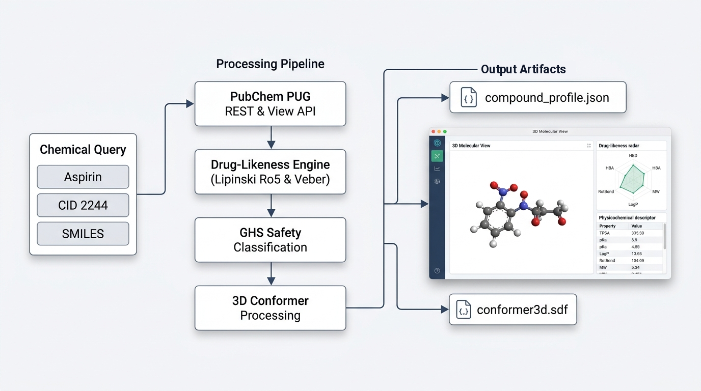

# PubChem Database Visualize Agent Skill

## 1. Overview
The `pubchem-database-visualize` skill provides an analytical and visualization toolkit for chemical compounds, pharmaceuticals, and biological ligands. Built for agentic harnesses compatible with standardized SKILL architectures, this skill automates the extraction and evaluation of chemical data from the National Center for Biotechnology Information (NCBI) PubChem database.



### Key Capabilities
- **Chemical Resolution**: Conversion of common trade names, systematic IUPAC nomenclature, SMILES strings, and InChI identifiers to canonical PubChem Compound IDs (CIDs).
- **Physicochemical Profiling**: Automated calculation of descriptors including molecular weight, octanol-water partition coefficient (XLogP), topological polar surface area (TPSA), hydrogen bond donor and acceptor counts, and rotatable bonds.
- **Medicinal Chemistry Rules**: Automated compliance assessment for Lipinski's Rule of Five and Veber bioavailability criteria, including violation details.
- **GHS Safety Intelligence**: Structured extraction of Globally Harmonized System (GHS) signal words, hazard statements (H-codes), precautionary statements (P-codes), and pictograms.
- **Clinical Pharmacology**: Therapeutic indication summaries, mechanisms of action, and biological macromolecular targets.
- **Interactive 3D Visualization**: Synthesis of standalone, self-contained UI dashboards (`dashboard.html`) featuring 3D molecular conformer rendering, drug-likeness radar charts, and bioassay tables.
- **Offline Synthetic Mock Mode**: Offline execution mode using synthetic data fixtures.

---

## 2. User Guide for Non-Technical Users

This section explains key chemistry concepts, how to interpret results, and how to interact with the visual dashboard.

### 2.1 What is PubChem?
PubChem is an open public chemical database maintained by the National Center for Biotechnology Information (NCBI), a division of the United States National Library of Medicine at the National Institutes of Health (NIH). PubChem catalogs millions of chemical substances, their molecular formulas, biological activities, physical properties, and safety records.

### 2.2 Understanding Chemical Identifiers
When researching a chemical, several identifiers can be used:
- **Common or Trade Name**: The everyday or commercial name of the substance (for example, "aspirin" or "caffeine").
- **PubChem CID (Compound Identifier)**: A unique integer assigned to every unique chemical structure in the PubChem database. For example, aspirin is CID 2244.
- **IUPAC Name**: The formal chemical name assigned using standardized rules from the International Union of Pure and Applied Chemistry. For example, aspirin is "2-acetyloxybenzoic acid".
- **SMILES (Simplified Molecular Input Line Entry System)**: A line notation that encodes a molecular structure using standard text characters (e.g., `CC(=O)OC1=CC=CC=C1C(=O)O`).
- **InChI and InChIKey**: Standardized digital identifiers that uniquely represent chemical structures and provide a searchable 27-character cryptographic hash.

### 2.3 Evaluating Drug-Likeness: Lipinski's Rule of Five
When pharmaceutical scientists discover or design a new molecule, they evaluate whether it has physical properties suitable for being taken as an oral medication (a swallowed pill or capsule) rather than requiring an injection.

In 1997, medicinal chemist Christopher Lipinski formulated the "Rule of Five". These rules define four thresholds (all based on multiples of five):

1. **Molecular Weight (under 500 grams per mole)**: Smaller molecules diffuse across intestinal cell membranes more readily than large molecules.
2. **Lipophilicity / XLogP (under 5)**: XLogP measures how well a molecule dissolves in fat compared to water. If the value is too high (above 5), the compound may become trapped in fat tissue and fail to circulate in the bloodstream. If it is too low (negative), it may not penetrate cell membranes.
3. **Hydrogen Bond Donors (no more than 5)**: Groups such as -OH (hydroxyl) and -NH (amine) that can donate hydrogen bonds. Too many donor sites make the molecule adhere strongly to surrounding water molecules, impeding membrane passage.
4. **Hydrogen Bond Acceptors (no more than 10)**: Oxygen or nitrogen atoms that can accept hydrogen bonds. Having more than 10 acceptors impairs passive absorption.

Compounds with zero or one violation are generally considered promising candidates for oral bioavailability. Compounds with two or more violations often require formulation modifications or alternative delivery methods.

In addition, the **Veber Rule** assesses two complementary physical traits:
- **Rotatable Bonds (10 or fewer)**: Measures molecular flexibility. Rigid molecules permeate membranes more efficiently.
- **Topological Polar Surface Area (TPSA under 140 square Angstroms)**: Measures the surface area occupied by polar atoms (oxygen, nitrogen, and attached hydrogens). Excessive polar surface area hinders cellular absorption.

### 2.4 Understanding Chemical Safety and GHS Classifications
The Globally Harmonized System (GHS) provides international standards for classifying and labeling chemical hazards:
- **Signal Words**:
  - `DANGER`: Indicates severe hazards (such as acute oral toxicity, severe corrosive effects, or significant organ damage).
  - `WARNING`: Indicates moderate or lower-level hazards (such as mild skin irritation or reversible eye discomfort).
  - `NOT_CLASSIFIED`: Indicates that mandatory hazardous substance filings are not present in the PubChem repository.
- **Hazard Statements (H-codes)**: Standardized phrases describing specific risks (for example, `H302: Harmful if swallowed`).

### 2.5 Interacting with the 3D Molecular View
The generated dashboard includes an interactive 3D viewer that lets you examine the spatial layout of atoms and bonds:
- **Rotate**: Left-click and drag across the viewer canvas to rotate the molecule along any axis.
- **Pan**: Right-click (or Shift + left-click) and drag to slide the molecule across the view.
- **Zoom**: Scroll your mouse wheel or pinch on a trackpad to zoom in for atom-level inspection or zoom out for an overview.
- **Display Modes**:
  - *Ball & Stick*: Default mode showing individual atom spheres connected by cylindrical bonds.
  - *Stick*: Displays covalent bond geometry.
  - *Spacefill (CPK)*: Displays each atom at its full van der Waals radius, showing the physical volume of the compound.
  - *Wireframe*: Renders thin lines connecting bond paths.
  - *Surface*: Displays a translucent volume outline surrounding the molecular frame.
- **Atom Labels**: Click the label button to toggle atomic element symbols (C, H, O, N, S) and numerical indices directly on atom centers.
- **Distance Measurement**: Click the measure tool, then click two separate atoms to measure the exact distance between their centers in Angstroms.
- **Light / Dark Mode**: Click the Sun or Moon icon in the dashboard header to toggle the theme.

### 2.6 Real-World Walkthrough Examples

#### Example 1: Aspirin (Over-the-Counter Pain Reliever)
- **Input**: Chemical name `"aspirin"` or CID `2244`.
- **Findings**:
  - Molecular Weight: 180.16 g/mol
  - XLogP: 1.2
  - Hydrogen Bond Donors: 1 | Acceptors: 4
  - Drug-Likeness: Fully compliant with Lipinski and Veber rules (0 violations).
  - Safety: Signal word `WARNING` with statement `H302: Harmful if swallowed`.
  - Target: Cyclooxygenase (COX-1 / COX-2) enzyme inhibition.

#### Example 2: Caffeine (Central Nervous System Stimulant)
- **Input**: Chemical name `"caffeine"` or CID `2519`.
- **Findings**:
  - Molecular Weight: 194.19 g/mol
  - XLogP: -0.1
  - Hydrogen Bond Donors: 0 | Acceptors: 6
  - Drug-Likeness: Fully compliant (0 violations).
  - Safety: Signal word `WARNING` (`H302: Harmful if swallowed`).
  - Target: Adenosine A1 and A2A receptor antagonism.

#### Example 3: Imatinib (Targeted Oncology Therapy)
- **Input**: Chemical name `"imatinib"` or CID `5291`.
- **Findings**:
  - Molecular Weight: 493.60 g/mol (near the 500 g/mol boundary).
  - XLogP: 3.5
  - Hydrogen Bond Donors: 2 | Acceptors: 7
  - Drug-Likeness: Fully compliant with Lipinski Rule of Five (0 violations); borderline rotatable bonds (7).
  - Mechanism: Tyrosine kinase inhibitor targeting the BCR-ABL fusion protein.

---

## 3. System Requirements & Setup

### System Requirements
- Operating System: Linux, macOS, or Windows (WSL recommended)
- Python Version: Python 3.10 or higher
- Package Manager: `uv` (recommended) or standard `pip`

### Virtual Environment Setup
Clone or place the repository in your workspace and configure an environment using `uv` or standard Python:

```bash
# Using uv (automatic environment resolution)
uv venv
source .venv/bin/activate

# Or using standard python venv
python3 -m venv .venv
source .venv/bin/activate
pip install -r requirements.txt
```

### PubChem Usage Policies
Programmatic access conforms to NCBI PUG-REST usage policies:
- Maximum request rate: 5 requests per second.
- Peak hours throttle considerations (Monday through Friday 9:00 AM - 5:00 PM US Eastern Time).
- The pipeline automatically validates or initializes `.licenses/pubchem_database_visualize_LICENSE.txt` upon execution.

---

## 4. Command Line Usage

### 4.1 Unified End-to-End Pipeline
The primary entry point is `scripts/run_pipeline.py`. It executes resolution, descriptor fetching, drug-likeness scoring, safety analysis, pharmacology retrieval, 3D conformer acquisition, bioassay filtering, analog searching, and dashboard compilation in a single run.

```bash
# Profile by common chemical or trade name
uv run scripts/run_pipeline.py --name "aspirin" -o ./output/aspirin/

# Profile by numerical Compound ID (CID)
uv run scripts/run_pipeline.py --cid 5291 -o ./output/imatinib/

# Profile by SMILES string
uv run scripts/run_pipeline.py --smiles "CN1C=NC2=C1C(=O)N(C(=O)N2C)C" -o ./output/caffeine/

# Profile by InChI string
uv run scripts/run_pipeline.py --inchi "InChI=1S/C9H8O4/c1-6(10)13-8-5-3-2-4-7(8)9(11)12/h2-5H,1H3,(H,11,12)" -o ./output/aspirin/
```

### 4.2 Offline Synthetic Mock Mode
When running in sandboxed, air-gapped, or continuous integration environments without external internet connectivity, pass the `--mock` flag:

```bash
uv run scripts/run_pipeline.py --name "aspirin" --mock -o ./output/aspirin_mock/
uv run scripts/run_pipeline.py --cid 60823 --mock -o ./output/atorvastatin_mock/
```

### 4.3 Modular Subcommands (`scripts/pubchem_api.py`)
Individual analytical stages can be executed independently:

```bash
# Resolve chemical name to CID
uv run scripts/pubchem_api.py resolve --name "aspirin" -o result.json

# Retrieve physicochemical properties and evaluate Lipinski / Veber rules
uv run scripts/pubchem_api.py properties --cid 2244 -o props.json

# Retrieve GHS safety hazard classification
uv run scripts/pubchem_api.py safety --cid 2244 -o safety.json

# Retrieve clinical pharmacology and target mechanisms
uv run scripts/pubchem_api.py pharmacology --cid 2244 -o pharm.json

# Retrieve 3D conformer coordinates in SDF format
uv run scripts/pubchem_api.py conformer3d --cid 2244 -o conformer3d.sdf

# Retrieve active bioassay screening results
uv run scripts/pubchem_api.py assays --cid 2244 --active-only -o assays.json

# Perform 2D similarity search for structural analogs
uv run scripts/pubchem_api.py similarity --cid 2244 --threshold 85 -o analogs.json
```

### 4.4 Executing the Test Suite
The repository includes unit, integration, and dashboard tests. All tests execute hermetically using synthetic data:

```bash
# Run test suite via dedicated CLI runner
uv run python tests/run_tests.py

# Or run directly with pytest
uv run pytest
```

---

## 5. Agent Harness Integration

This section outlines how autonomous agents execute the skill when responding to user requests.

### 5.1 Skill Loading
Ensure the skill directory is located within your agent's active workspace or registered in your harness's skill discovery paths. The agent reads `SKILL.md` automatically when chemical profiling tasks are requested.

### 5.2 Sample User Inquiries
- "Look up aspirin in PubChem, evaluate its drug-likeness according to Lipinski's rules, and show me its 3D molecular structure."
- "Profile the kinase inhibitor imatinib. Check its GHS hazard statements, clinical targets, and generate an interactive dashboard."
- "Analyze this SMILES string: CC(=O)OC1=CC=CC=C1C(=O)O. Report its physicochemical properties and identify similar chemical analogs."
- "Run an offline synthetic profile on Atorvastatin (CID 60823) and check for any Veber rule violations."

### 5.3 Generated Artifacts
Execution generates three core artifacts in the destination output directory:
1. `compound_profile.json`: Full machine-readable dataset including identifiers, properties, drug-likeness evaluation, safety, pharmacology, bioassays, and analogs.
2. `conformer3d.sdf`: Spatial coordinate file containing 3D atomic coordinates.
3. `dashboard.html`: Self-contained interactive UI dashboard featuring:
   - Light and Dark theme toggle with persistent state.
   - 3D Molecular View with HiDPI rendering, specular shading, representation modes, distance measurement, atom inspector, and PNG export.
   - Oral drug-likeness radar chart mapping Lipinski and Veber criteria.
   - GHS hazard classification panel and clinical pharmacology summary.
   - Instant clipboard copy utilities for chemical notations.

---

## 6. Project Structure

```text
pubchem-database-visualize-skill/
├── .gitignore
├── .licenses/
│   └── pubchem_database_visualize_LICENSE.txt
├── LICENSE
├── README.md
├── requirements.txt
├── pyproject.toml
├── SKILL.md
├── dashboard.html
├── assets/
│   ├── dashboard_template.html
│   ├── schemas/
│   │   └── compound_profile_schema.json
│   ├── skill_workflow_overview.png
│   └── synthetic_mocks.json
├── documents/
│   └── prd.md
├── references/
│   ├── drug_likeness_standards.md
│   ├── ghs_hazard_codes.md
│   └── pubchem_api_reference.md
├── scripts/
│   ├── pubchem_api.py
│   └── run_pipeline.py
└── tests/
    ├── conftest.py
    ├── run_tests.py
    ├── test_dashboard.py
    ├── test_pipeline.py
    └── test_pubchem_api.py
```

---

## 7. License
This project is licensed under the Apache License, Version 2.0. See the [LICENSE](LICENSE) file for the full license text.

PubChem data citations and PUG-REST usage policies are acknowledged and maintained in [.licenses/pubchem_database_visualize_LICENSE.txt](.licenses/pubchem_database_visualize_LICENSE.txt).

